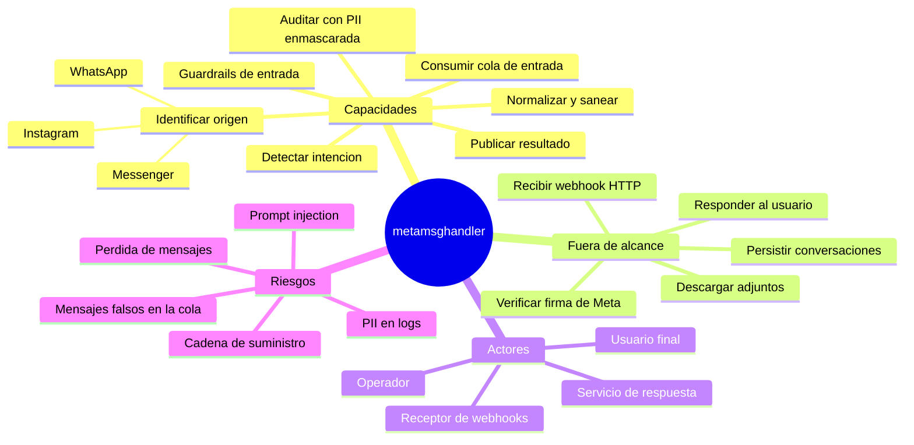

# Project Charter — ms-python-metamsghandler

* **Estado:** review
* **Fecha:** 2026-10-12
* **Decisores:** Jeremi Alcalá (owner / tech lead)
* **Fase AI-DLC:** 00-project
* **Versión:** 0.1.0
* **Sponsor:** <TODO: confirmar quién patrocina>
* **Owner del proyecto:** Jeremi Alcalá

## Visión

Clasificar de forma segura cada mensaje entrante de Messenger, WhatsApp e Instagram
(origen, política de seguridad e intención) para que un servicio aguas abajo decida y
entregue la respuesta, sin exponer el modelo de lenguaje a entradas no confiables sin control.

## Alcance

- Incluye:
  - Consumo de webhooks de Meta desde una cola de RabbitMQ, con confirmación explícita (ACK/NACK).
  - Identificación del origen y normalización a `MensajeEntrante` para las tres plataformas,
    más el sobre custom `jwe_body` que emite el receptor de WhatsApp aguas arriba.
  - Capa de seguridad de entrada (NeMo Guardrails) con política fail-closed.
  - Detección de intención con un LLM servido por Ollama y clasificación en `texto`, `action` o `adjunto`.
  - Publicación del `ResultadoClasificado` en la cola de salida, también cuando la entrada se bloquea.
  - Auditoría por etapa con el identificador del remitente enmascarado.
- **No incluye (no-scope):**
  - Recepción HTTP del webhook y verificación de la firma de Meta: es responsabilidad del receptor aguas arriba.
  - Generación y entrega de la respuesta al usuario (la «Fase 4» del README).
  - Descarga, almacenamiento o análisis del contenido de los adjuntos: solo se propaga la referencia.
  - Persistencia de conversaciones o historial.
  - Alta y configuración de bots o inquilinos.
  - Operación del broker RabbitMQ.

## Mapa mental del alcance

*Caption — eje trazabilidad/plan, fase 00-project: alcance, actores y riesgos de alto nivel.*

## Stakeholders

| Rol | Nombre | Responsabilidad |
|---|---|---|
| Owner / tech lead | Jeremi Alcalá | Arquitectura, implementación, aprobación de gates |
| Sponsor | <TODO: confirmar> | Prioridad y presupuesto (incluye el coste del serving del LLM, ver ADR-0007) |
| Seguridad / DPO | <TODO: confirmar> | Clasificación de datos, base legal GDPR y leyes LatAm, revisión del threat model |
| Owner del receptor de webhooks | <TODO: confirmar> | Verificación de la firma de Meta y contrato de la cola de entrada |
| Owner del servicio de respuesta | <TODO: confirmar> | Consumo del `ResultadoClasificado` y entrega al usuario |

## Restricciones y supuestos

- **Python 3.12** fijado: los pins de `requirements.txt` dependen de esa versión.
- `nemoguardrails` arrastra `annoy`, sin wheel para Windows: build y tests completos en Linux (Docker/WSL).
- El repositorio es **público** en GitHub: prompts, reglas de guardrails y contratos son de dominio público.
- Los usuarios finales están en la UE y en Latinoamérica: aplica GDPR y la ley de protección de
  datos de cada país de operación (ver `data-classification.md`).
- Supuesto: el productor de la cola de entrada es el servicio `wh-python-fastapi-messenger`.
  Se infiere de la forma del sobre `jwe_body` que acepta `WhatsAppParser`. <TODO: confirmar>
- Supuesto: la plataforma se llama Chatters Pro. Se infiere del namespace y del registry de
  `deployment.yaml`, que es un borrador heredado de un template. <TODO: confirmar>
- El servicio aún no está desplegado en ningún entorno (confirmado el 2026-10-12).

## Métricas de éxito del proyecto

Las definiciones salen del comportamiento actual del pipeline. Los umbrales son propuestas
para decisión humana: ninguno está medido hoy.

| Métrica | Definición | Objetivo |
|---|---|---|
| Tasa de clasificación efectiva | Mensajes con `confianza >= 0.3` sobre mensajes con texto | <TODO: fijar> |
| Latencia cola a cola (p95) | Desde la entrega AMQP hasta la publicación del resultado | <TODO: fijar; hoy el timeout del motor de intención es 15 s> |
| Falsos positivos del rail | Mensajes legítimos bloqueados sobre mensajes evaluados | <TODO: fijar con un corpus de evaluación> |
| PII en claro en logs | Remitentes o textos sin enmascarar en los logs | 0 |
| Mensajes perdidos | Mensajes consumidos sin resultado publicado ni registro en DLQ | 0 |
| Cobertura de rama | `pytest --cov-branch` | >= 80 % (Gate 2); hoy 70 % |

## Riesgos de alto nivel

| Riesgo | Efecto | Dónde se trata |
|---|---|---|
| Prompt injection que evade el rail | Clasificación manipulada, acción indebida aguas abajo | Threat model T1, T2 |
| PII y texto de mensajes en logs | Incumplimiento GDPR / leyes LatAm | Threat model T3 |
| Mensajes falsos inyectados en la cola | Suplantación del remitente | Threat model T4 |
| Pérdida silenciosa de mensajes | El usuario no recibe respuesta | Threat model T6 |
| Coste y latencia del LLM autoalojado | Inviabilidad económica o timeouts | ADR-0007 |
| Sin CI ni análisis de dependencias | Regresiones y CVEs sin detectar | Gates 2 y 4 |
