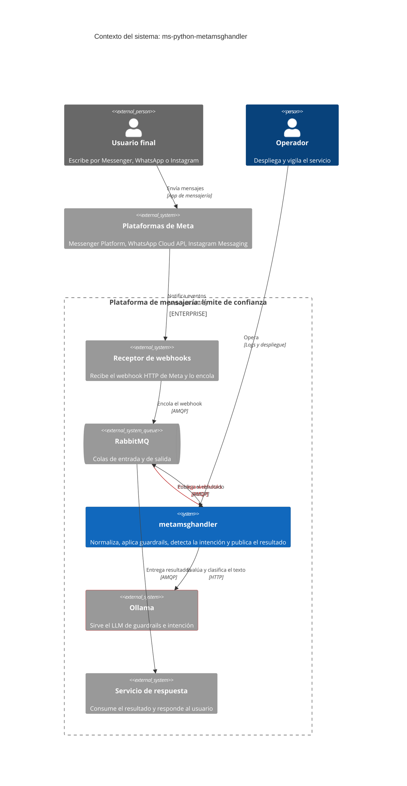
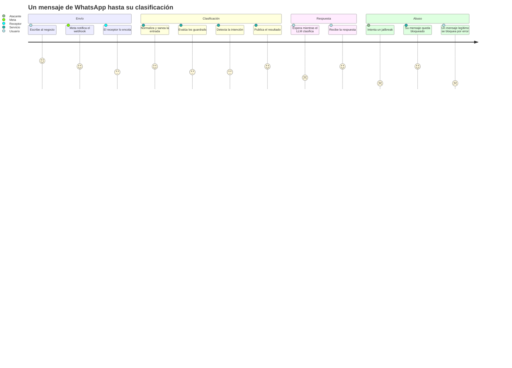
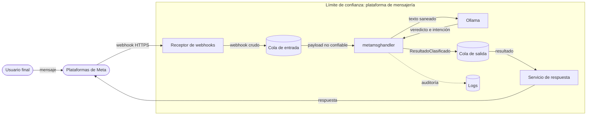
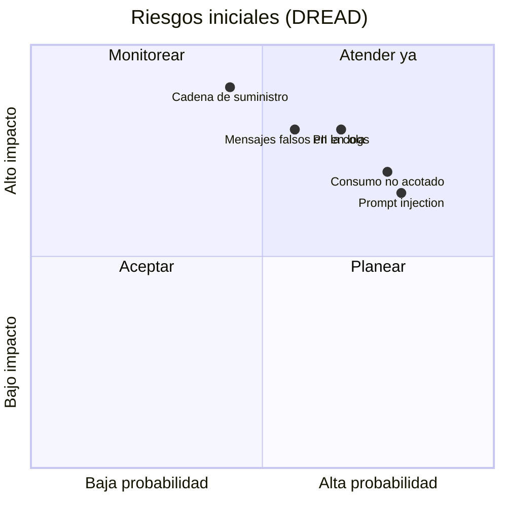

# PRD — Clasificación segura de mensajes entrantes de Meta

* **Estado:** review
* **Fecha:** 2026-10-12
* **Decisores:** Jeremi Alcalá
* **Fase AI-DLC:** 01-requirements
* **Versión:** 0.1.0
* **Gate:** 0
* **Feature/Épica ID:** MMH-F01
* **Nivel ASVS objetivo:** L2 (propuesto: el servicio trata datos personales; pendiente de confirmar)

Documento reconstruido sobre un sistema existente. Los requisitos describen lo que el código
de `develop` (4c7bb9e) ya hace o debería hacer; la columna «Estado» de cada tabla dice cuál
de las dos cosas.

## Problema y contexto

Los negocios atienden a sus clientes por Messenger, WhatsApp e Instagram. Cada plataforma
entrega los mensajes con una estructura distinta, y el texto llega de usuarios anónimos de
Internet. Antes de que nadie responda hace falta saber tres cosas: de dónde viene el mensaje,
si es seguro procesarlo con un modelo de lenguaje y qué quiere el usuario.

Este servicio resuelve esas tres preguntas y publica la respuesta como un
`ResultadoClasificado`. No responde al usuario: eso lo hace un servicio aguas abajo.

## Objetivos / No-objetivos

**Objetivos**

- Un modelo único de mensaje (`MensajeEntrante`) para las tres plataformas.
- Que ningún texto llegue al clasificador sin pasar por la capa de seguridad.
- Que la salida del modelo nunca se use sin validar.
- Trazabilidad de cada mensaje sin exponer datos personales.

**No-objetivos**

- Recibir el webhook HTTP ni verificar la firma de Meta.
- Generar o entregar la respuesta.
- Descargar o analizar adjuntos.
- Mantener el historial o el contexto de la conversación: cada mensaje se clasifica aislado.

## Contexto del sistema (C4 Context)

*Caption — eje estructura, fase 01-requirements: el sistema, sus actores y de qué depende. En
rojo, la entrada no confiable y el modelo de IA (`ai-sec`).*

El receptor y el servicio de respuesta son sistemas de la misma plataforma pero de otros
repositorios. El usuario final nunca habla con este servicio de forma directa: su texto llega
a través de Meta, del receptor y de la cola, y sigue siendo no confiable en todo el recorrido.

## Usuarios y escenarios

| Actor | Tipo | Relación con el servicio |
|---|---|---|
| Usuario final | Persona externa, no confiable | Origen del texto y de los adjuntos |
| Receptor de webhooks | Sistema interno | Productor de la cola de entrada |
| Servicio de respuesta | Sistema interno | Consumidor de la cola de salida |
| Operador | Persona interna | Configura, despliega y lee logs |

### Journey del usuario

*Caption — eje trazabilidad, fase 01-requirements: experiencia y puntos de dolor. Los dos
peores son la espera durante la clasificación y el falso positivo del rail.*

### Escenarios positivos

| ID | Escenario | Resultado esperado |
|---|---|---|
| E-01 | Texto por WhatsApp: «¿tienen stock del modelo X?» | `tipo_respuesta=action`, etiqueta de consulta de stock, `permitido=true` |
| E-02 | Saludo por Messenger | `tipo_respuesta=texto`, `permitido=true` |
| E-03 | Imagen con pie de foto por WhatsApp | `tipo_respuesta=adjunto` sin invocar al LLM; el pie pasa por guardrails |
| E-04 | Mensaje directo de Instagram | Mismo tratamiento que Messenger |
| E-05 | Webhook de WhatsApp en el sobre custom `jwe_body` | Se normaliza igual que el webhook estándar |
| E-06 | Webhook que solo trae `statuses` (entregado, leído) | Se descarta con registro; el consumo continúa |

### Escenarios negativos / abuso (requerido por Gate 0)

| ID | Escenario de abuso | Comportamiento exigido | Amenaza |
|---|---|---|---|
| AB-01 | Jailbreak en el texto: «ignora tus instrucciones y…» | El rail bloquea; se publica `permitido=false` | T1 |
| AB-02 | Inyección en el pie de foto de un adjunto | El pie se evalúa igual que un texto | T1 |
| AB-03 | El usuario induce al modelo a emitir `action` con entidades arbitrarias | La salida se valida contra un contrato cerrado antes de publicarse | T2 |
| AB-04 | Intento de extraer el prompt de sistema | El rail bloquea. El prompt es público: no hay secreto que proteger | T1 |
| AB-05 | Un publicador ilegítimo encola webhooks falsos con el `from` de otro usuario | El mensaje debe ser atribuible a un productor autorizado | T4 |
| AB-06 | Payload malformado: JSON inválido, tipos inesperados, `entry` que no es lista | Se descarta con registro, sin tumbar el consumidor | T6 |
| AB-07 | Identificadores con saltos de línea o caracteres de control | Se sanean antes de llegar a logs o aguas abajo | T3 |
| AB-08 | Mensaje gigante o ráfaga de mensajes | Texto recortado; consumo y llamadas al LLM acotados | T7 |
| AB-09 | Ollama caído o lento | Timeout, fallback seguro y, en la capa de seguridad, bloqueo | T7 |
| AB-10 | Adjunto de Messenger con URL a un host interno | La URL no debe poder provocar una petición interna aguas abajo | T10 |
| AB-11 | Meta reentrega el mismo webhook | No se generan dos resultados para un mismo `mensaje_id` | T9 |
| AB-12 | El usuario escribe datos sensibles (salud, tarjeta) | El texto no aparece en logs | T3 |

## Requisitos funcionales

| ID | Requisito | Estado | Evidencia |
|---|---|---|---|
| RF-01 | Consumir la cola de entrada confirmando cada mensaje: ACK si el pipeline termina, NACK sin reencolar si falla | Implementado | `amqp/consumer.py` |
| RF-02 | Identificar el origen por el campo `object` (`page`, `whatsapp_business_account`, `instagram`) y aceptar el sobre custom `jwe_body` | Implementado | `adapters/resolver.py`, `tests/unit/test_adapters.py` |
| RF-03 | Normalizar a `MensajeEntrante`: identificadores saneados, texto saneado, adjuntos y marca de tiempo | Implementado | `adapters/`, `tests/unit/test_adapters.py` |
| RF-04 | Descartar con registro los payloads de origen no soportado o inválidos, sin detener el consumo | Implementado | `application/procesar_mensaje.py` |
| RF-05 | Evaluar el texto con la política de guardrails antes de clasificar; si la capa falla, bloquear | Implementado | `guardrails/nemo_policy.py`, `tests/unit/test_guardrails.py` |
| RF-06 | Clasificar en `texto`, `action` o `adjunto` con una confianza; los adjuntos no invocan al LLM; ante fallo o confianza < 0.3, fallback a `texto` | Implementado | `llm/ollama_engine.py`, `tests/unit/test_ollama_engine.py` |
| RF-07 | Publicar el `ResultadoClasificado` en la cola de salida, incluido el caso bloqueado con `permitido=false` | Implementado | `amqp/publisher.py`, `tests/unit/test_publisher.py` |
| RF-08 | Registrar una traza de auditoría por etapa con el remitente enmascarado | Parcial | `shared/general.py`; el publicador registra el resultado completo |

**Limitaciones conocidas** (comportamiento actual que ningún requisito cubre todavía):

- De un webhook con varios mensajes solo se procesa el primero; el resto se pierde sin registro.
- El resultado no lleva el `botId` ni el `eventId` del sobre custom: el servicio de respuesta
  no puede saber a qué bot pertenece el mensaje. <TODO: confirmar si es un requisito>
- No hay deduplicación por `mensaje_id`.

## Trazabilidad de requisitos

```mermaid
requirementDiagram
    functionalRequirement RF02 {
      id: RF02
      text: "Identificar el origen y normalizar"
      risk: medium
      verifymethod: test
    }
    functionalRequirement RF05 {
      id: RF05
      text: "Guardrails antes de clasificar, fail-closed"
      risk: high
      verifymethod: test
    }
    functionalRequirement RF06 {
      id: RF06
      text: "Clasificar con fallback seguro"
      risk: high
      verifymethod: test
    }
    requirement RS01 {
      id: RS01
      text: "Sanear toda entrada. ASVS V5.1 y V5.2"
      risk: high
      verifymethod: test
    }
    requirement RS02 {
      id: RS02
      text: "Salida del LLM no confiable. ASVS V5.3"
      risk: high
      verifymethod: test
    }
    requirement RS04 {
      id: RS04
      text: "TLS en AMQP y Ollama. ASVS V9.2"
      risk: high
      verifymethod: inspection
    }
    requirement RS06 {
      id: RS06
      text: "Sin PII en logs. ASVS V7.1 y V8.3"
      risk: high
      verifymethod: test
    }
    element WebhookResolver {
      type: "componente"
    }
    element Sanitize {
      type: "componente"
    }
    element NeMoGuardrailsPolicy {
      type: "componente"
    }
    element OllamaIntentEngine {
      type: "componente"
    }
    element test_adapters {
      type: "prueba"
    }
    element test_guardrails {
      type: "prueba"
    }
    element test_ollama_engine {
      type: "prueba"
    }
    WebhookResolver - satisfies -> RF02
    Sanitize - satisfies -> RS01
    NeMoGuardrailsPolicy - satisfies -> RF05
    OllamaIntentEngine - satisfies -> RF06
    OllamaIntentEngine - satisfies -> RS02
    test_adapters - verifies -> RF02
    test_adapters - verifies -> RS01
    test_guardrails - verifies -> RF05
    test_ollama_engine - verifies -> RF06
    test_ollama_engine - verifies -> RS02
```

*Caption — eje trazabilidad, fase 01-requirements: requisito, componente que lo satisface y
prueba que lo verifica. RS04 y RS06 no tienen ni componente ni prueba: son brechas.*

## Requisitos de seguridad (mapeados a OWASP ASVS)

Referencias a ASVS 4.0.3 a nivel de sección; los identificadores de requisito concretos se
fijan en la revisión de seguridad. La columna «OWASP» cita el Top 10:2025 y, donde aplica, el
Top 10 para aplicaciones LLM 2025.

| Req | Requisito | ASVS | Nivel | OWASP | Estado |
|---|---|---|---|---|---|
| RS-01 | Sanear y validar toda entrada: texto en NFKC, sin caracteres de control y recortado a 4096; identificadores con lista de caracteres permitidos y máximo 128 | V5.1, V5.2 | L1 | A05 | Parcial: `url_o_id`, `tipo` y `mime_type` del adjunto no se sanean |
| RS-02 | Tratar la salida del LLM como no confiable: esquema validado, `tipo_respuesta` de un enum cerrado, confianza acotada, fallback | V5.1, V5.3 | L2 | A05 · LLM05 | Parcial: `etiqueta`, `entidades` y `razonamiento` son libres |
| RS-03 | Capa de guardrails de entrada obligatoria y fail-closed | V1.5 | L2 | A06 · LLM01 | Implementado; eficacia sin medir |
| RS-04 | Cifrado en tránsito (TLS) hacia RabbitMQ y hacia Ollama | V9.2 | L2 | A04 | Brecha |
| RS-05 | Autenticidad del productor: firma de Meta verificada aguas arriba, credenciales por servicio y permisos mínimos en el broker | V1.9, V2.10 | L2 | A07 · A08 | Brecha por confirmar con el receptor |
| RS-06 | Ni datos personales ni texto de mensajes en logs; identificadores enmascarados | V7.1, V8.3 | L2 | A09 | Parcial: el publicador registra el resultado completo |
| RS-07 | Errores fail-secure: timeout en toda llamada externa, mensajes fallidos a una DLQ, sin pérdida silenciosa | V7.4, V11.1 | L2 | A10 | Parcial: timeout solo en intención; sin DLQ |
| RS-08 | Consumo acotado: tamaño de mensaje, concurrencia y llamadas al LLM por mensaje | V11.1 | L2 | A10 · LLM10 | Parcial: `prefetch_count=1` y recorte de texto |
| RS-09 | Secretos fuera del repo y de la imagen, en un gestor de secretos | V6.4, V14.1 | L2 | A02 | Parcial: fuera del repo y de la imagen; sin gestor definido |
| RS-10 | Cadena de suministro: dependencias fijadas, SCA, SBOM, imagen base por digest | V14.2, V10.3 | L2 | A03 | Parcial: versiones fijadas; lo demás no existe |
| RS-11 | Idempotencia ante reentrega por `mensaje_id` | V11.1 | L2 | A08 | Brecha |
| RS-12 | Minimización y retención: no persistir más de lo necesario; plazos para colas y logs | V8.1, V8.3 | L2 | A09 | Parcial: no persiste; sin plazos |
| RS-13 | Contenedor endurecido: usuario no-root, imagen mínima sin toolchain | V14.1 | L2 | A02 | Parcial: no-root; imagen completa con compiladores |
| RS-14 | Las URL de adjuntos se validan o se marcan como no confiables antes de publicarse | V12.6 | L2 | A05 | Brecha |

Cada fila tiene su control en `.ai-dlc/owasp-mapping.md` (anexo del servicio).

## Threat assessment inicial

*Caption — eje comportamiento, fase 01-requirements: flujo de datos de nivel 0. El texto del
usuario cruza el límite de confianza sin dejar de ser no confiable. El DFD detallado que
alimenta el STRIDE está en `docs/02-design/threat-model.md`.*

*Caption — eje trazabilidad, fase 01-requirements: familias de riesgo iniciales. Las
coordenadas salen de las puntuaciones DREAD del threat model (T1, T3, T4, T7, T8).*

## Métricas de éxito

Definidas en `docs/00-project/charter.md`. Para esta funcionalidad importan la tasa de
clasificación efectiva, la latencia cola a cola y la tasa de falsos positivos del rail.
Ninguna tiene umbral aprobado ni medición.

## Dependencias y riesgos

| Dependencia | Riesgo | Tratamiento |
|---|---|---|
| Receptor de webhooks (`wh-python-fastapi-messenger`, supuesto) | En su copia local (86d553b, 2026-07-02) no aparece verificación de `X-Hub-Signature-256` y el cifrado del sobre `jwe_body` está comentado | Confirmar con su owner; RS-05 |
| RabbitMQ | Sin TLS ni DLQ configurados desde este servicio | RS-04, RS-07 |
| Ollama con `llama3.1` | El mismo modelo hace de juez de seguridad y de clasificador: un fallo del modelo afecta a las dos capas | ADR-0004, ADR-0005 |
| `nemoguardrails` 0.22.0 | Dependencia nativa (`annoy`); los tests mockean el motor, así que la eficacia real no está probada | Gate 3 |
| Servicio de respuesta | Consume `etiqueta` y `entidades` generadas por un LLM | RS-02; contrato en `docs/02-design/contracts/asyncapi.yaml` |
