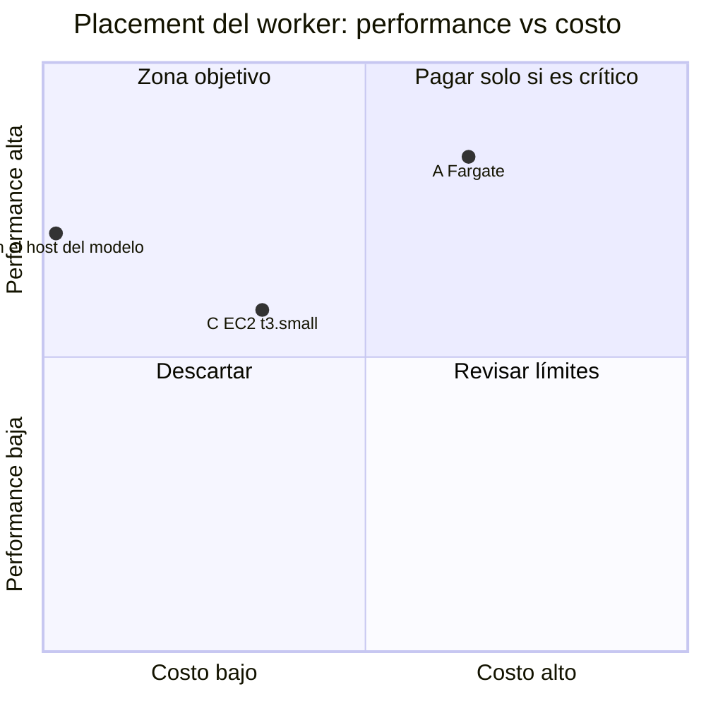

# ADR-0006: Placement de despliegue — worker de clasificación

* **Estado:** proposed
* **Fecha:** 2026-10-12
* **Decisores:** Jeremi Alcalá
* **Fase AI-DLC:** 02-design
* **Versión:** 0.1.0
* **ID:** ADR-0006
* **Supersede:** —
* **OWASP:** A02 (configuración del contenedor y secretos), A04 (TLS hacia el broker y el modelo), A03 (imagen y pipeline)

Queda en `proposed` porque depende de ADR-0007: dónde vive el modelo decide dónde conviene
poner el worker.

## Contexto

- **Perfil:** clase D (worker). Un proceso Python 3.12 en contenedor que mantiene una conexión
  AMQP abierta todo el tiempo, sin puertos de entrada. Procesa en serie y pasa casi todo su
  tiempo esperando al modelo.
- **Estado actual:** sin desplegar. `deployment.yaml` es un borrador heredado de un template:
  nombre e imagen de otro servicio, etiqueta `:latest`, sin límites, sin sondas, sin
  `securityContext` y sin montaje de secretos (T12).
- **Tamaño supuesto:** 1 vCPU y 2 GB. <TODO: medir la memoria real con NeMo cargado>
- **Tráfico esperado a 12 meses:** <TODO: confirmar>. El coste del worker es fijo mientras baste
  una instancia; el caudal lo limita el modelo, no el worker.
- **Restricciones:** imagen x86 (`annoy` se compila en el build y no se ha probado en ARM);
  necesita alcanzar el broker y el serving del modelo; trata datos personales.

## Candidatos evaluados

Costes de lista consultados el 2026-10-12 en us-east-1, mes de 730 horas, sin impuestos.
«Latencia» mide aquí la cercanía al modelo y al broker, no al usuario: el flujo es asíncrono.

| Criterio (peso) | A. ECS Fargate 1 vCPU / 2 GB | B. Contenedor en el host del modelo | C. EC2 t3.small |
|---|---|---|---|
| Latencia al modelo y al broker (30%) | 4 | 5 | 4 |
| Escalabilidad (20%) | 5 | 2 | 2 |
| Cold start / SLA (15%) | 4 | 3 | 3 |
| Límites técnicos (15%) | 4 | 4 | 3 |
| Carga operativa (20%) | 4 | 3 | 2 |
| **Score_perf** | 4.20 | 3.55 | 2.90 |
| **Costo est. USD/mes** | $39.69 | $0 marginal | $20.43 |
| **PxD** | 1.06 | **35.5** | 1.42 |

Cómo sale cada coste:

- **A:** ($0.04048 + 2 × $0.004445) × 730 = $36.04, más una IPv4 pública ($3.65) para salir sin
  NAT Gateway, que costaría $32.85 al mes. En eu-central-1 la tarea cuesta $41.45 y en
  sa-east-1 $61.90.
- **B:** el host lo paga ADR-0007. La fórmula usa un costo mínimo de 1 para no dividir por cero.
  Solo existe si ADR-0007 elige un host propio o dedicado con capacidad libre.
- **C:** $0.0208/h × 730 = $15.18, más 20 GB de gp3 ($1.60) y una IPv4 pública ($3.65). Sus
  2 GiB de RAM son justos para el tamaño supuesto.

*Caption — eje trazabilidad/plan, fase 02-design: el eje de costo va de 0 a 60 USD por mes.*

**Descartados por el árbol de decisión**

- **Cloudflare Workers:** el runtime no admite las dependencias nativas (`annoy`) ni una
  conexión AMQP abierta de forma permanente.
- **AWS Lambda:** el consumidor mantiene la conexión abierta; dispararlo desde la cola exigiría
  Amazon MQ, cuyo broker más pequeño que se puede crear hoy (mq.m7g.medium) cuesta $99.79 al
  mes, y reescribir el consumo.
- **Kubernetes propio:** el manifest existente lo sugería, pero no hay cluster. Montar uno para
  un solo worker no se justifica.

## Decisión

**Propuesta: B, contenedor en el mismo host que el modelo**, con Docker Compose, si ADR-0007
acaba en un host dedicado. PxD de 35.5 frente a 1.42 y 1.06, y además el enlace con Ollama
queda en la interfaz local, sin red de por medio.

Si ADR-0007 acaba en inferencia gestionada (no hay host), la fórmula elige **C, EC2 t3.small**
(1.42 frente a 1.06, una diferencia del 34 %, por encima del umbral de empate del 15 %). Antes
de aceptarlo hay que medir la memoria del worker: si no cabe en 2 GiB, el candidato cambia.

**CD: GitHub Actions.** El pipeline lleva tests y los gates de seguridad, y el destino no es
Cloudflare. El repositorio es público, así que el uso de runners estándar es gratuito.

## Consecuencias

- Positivas: coste marginal nulo; sin tráfico de datos personales entre el worker y el modelo
  por la red; un solo host que endurecer y vigilar.
- Negativas: el worker hereda el punto único de fallo del host del modelo y compite con él por
  CPU y RAM; no hay escalado automático; el despliegue por SSH o por un agente en el host
  necesita su propio diseño de credenciales.
- Lock-in aceptado: bajo. Es un contenedor estándar; moverlo a Fargate es cambiar la definición
  del despliegue.
- Trabajo que esta decisión abre para Gate 4: sustituir `deployment.yaml` por la definición
  real, con usuario no-root (ya en la imagen), límites de recursos, secretos montados desde un
  gestor, imagen etiquetada por commit y `amqps` hacia el broker.
- **Condiciones de revisión:**
  - ADR-0007 se acepta con otro resultado.
  - El volumen exige más de un worker en paralelo.
  - Se necesita alta disponibilidad (el servicio pasa a tener un SLO).
  - La memoria medida no cabe en el tamaño supuesto.
  - Caducidad de los precios: 2027-04-12.

## Fuentes de precios (consultadas el 2026-10-12)

| Dato | Valor | Fuente |
|---|---|---|
| Fargate Linux x86 | us-east-1: $0.04048 por vCPU-hora y $0.004445 por GB-hora; sa-east-1: $0.0696 y $0.0076; eu-central-1: $0.04656 y $0.00511 | AWS Price List, AmazonECS (publicado el 2026-09-11); https://aws.amazon.com/fargate/pricing/ |
| EC2 t3.small Linux bajo demanda | us-east-1 $0.0208 por hora; sa-east-1 $0.0336; eu-central-1 $0.0240 | Datos que carga https://aws.amazon.com/ec2/pricing/on-demand/ (2026-10-09) |
| EBS gp3 | $0.08 por GB-mes | AWS Price List, AmazonEC2 us-east-1 (2026-10-09) |
| IPv4 pública | $0.005 por hora | https://aws.amazon.com/vpc/pricing/ |
| NAT Gateway | $0.045 por hora y $0.045 por GB | AWS Price List, AmazonEC2 us-east-1 (2026-10-09) |
| Amazon MQ para RabbitMQ, mq.m7g.medium | $0.1367 por hora | AWS Price List, AmazonMQ (2026-09-11) |
| GitHub Actions | Gratis en repositorios públicos con runners estándar; en privados, 2 000 minutos al mes y $0.006 por minuto en Linux de 2 núcleos | https://docs.github.com/en/billing/concepts/product-billing/github-actions |

Como referencia fuera de AWS, el plan compartido más pequeño de Hetzner que se puede contratar
hoy con 2 vCPU y 4 GB (CPX22) cuesta €19.99 al mes en la UE, sin IVA
(https://www.hetzner.com/cloud/regular-performance/).
