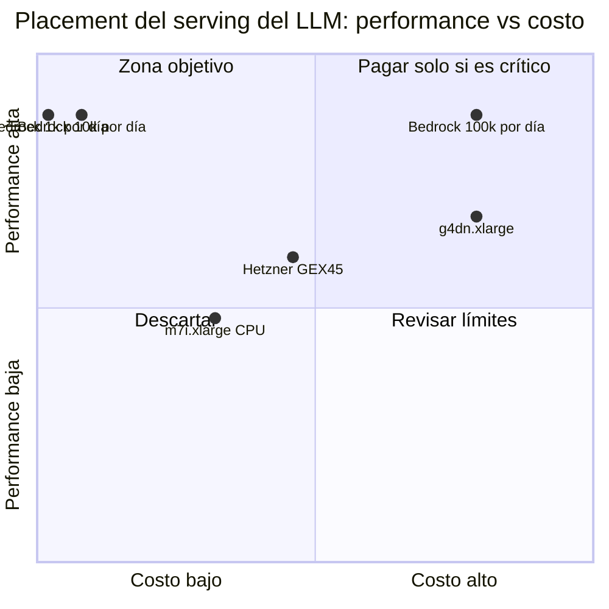

# ADR-0007: Placement de despliegue — serving del LLM

* **Estado:** proposed
* **Fecha:** 2026-10-12
* **Decisores:** Jeremi Alcalá · sponsor y DPO <TODO: confirmar>
* **Fase AI-DLC:** 02-design
* **Versión:** 0.1.0
* **ID:** ADR-0007
* **Supersede:** —
* **OWASP:** A04 (cifrado y residencia de datos), A02 (endurecimiento del host), A03 · LLM03 (procedencia del modelo), LLM10 (consumo)

Queda en `proposed`: la decisión depende de dos datos que no están en el repositorio, el
volumen de mensajes y si los datos personales pueden salir a un proveedor en Estados Unidos.

## Contexto

- **Perfil:** clase E (especial). Sirve `llama3.1` de 8B parámetros para dos usos por mensaje:
  el rail de entrada y la clasificación de intención (ADR-0004, ADR-0005). Necesita GPU o mucha
  RAM, y trata datos personales de usuarios de la UE y de Latinoamérica.
- **Estado actual:** no hay nada desplegado. En desarrollo, Ollama corre en `localhost:11434`.
- **Tráfico esperado a 12 meses:** <TODO: confirmar mensajes por día>. Es el dato que más mueve
  el resultado, así que la matriz se calcula en tres escenarios.
- **Restricciones:**
  - El motor de intención corta a los 15 s; el pipeline procesa en serie (`prefetch_count=1`),
    así que la latencia del modelo fija el caudal máximo. **No está medida.**
  - GDPR y leyes LatAm: la región y el proveedor son decisiones de residencia y de
    transferencia internacional de datos.
  - El flujo es asíncrono: la latencia de red hasta el usuario final no cuenta; cuenta la
    latencia de inferencia y la del enlace con el worker.

## Candidatos evaluados

Costes de lista consultados el 2026-10-12, mes de 730 horas, sin impuestos. Las fuentes están
al final. Los pesos son los de la guía de deployment placement.

| Criterio (peso) | EC2 g4dn.xlarge (GPU T4 16 GB) | EC2 m7i.xlarge (solo CPU, 16 GB) | Hetzner GEX45 (GPU 24 GB, dedicado) | Amazon Bedrock, Llama 3.1 8B |
|---|---|---|---|---|
| Latencia de inferencia (30%) | 4 | 1 | 4 | 4 |
| Escalabilidad (20%) | 3 | 3 | 1 | 5 |
| Cold start / SLA (15%) | 4 | 4 | 3 | 5 |
| Límites técnicos (15%) | 4 | 2 | 5 | 3 |
| Carga operativa (20%) | 2 | 3 | 2 | 5 |
| **Score_perf** | 3.40 | 2.40 | 3.00 | 4.40 |
| **Costo est. / mes** | $395.63 (us-east-1) | $158.82 (us-east-1) | €231.42 | $3.96 · $39.60 · $396.00 |
| **PxD** | 0.086 | 0.151 | 0.130 | **11.1** · **1.11** · 0.111 |

Cómo sale cada coste:

- **g4dn.xlarge:** $0.526/h × 730 = $383.98, más 100 GB de gp3 ($8.00) y una IPv4 pública ($3.65).
  La misma instancia cuesta $480.34 en eu-central-1 y $652.62 en sa-east-1 (solo la instancia).
- **m7i.xlarge:** $0.2016/h × 730 = $147.17, más los mismos $11.65. La puntuación 1 en latencia
  es un juicio sin medición: con CPU hay riesgo de superar el timeout de 15 s.
- **GEX45:** €214.00 al mes más €209.00 de alta, prorrateada en 12 meses. El importe está en
  **euros sin convertir**: el PxD real en dólares es algo menor (a 1.25 USD/EUR sería 0.104).
  Solo hay centros de datos en Europa. Tiene 64 GB de RAM: cabe también el worker (ADR-0006).
- **Bedrock:** $0.00022 por 1 000 tokens de entrada y de salida. Los tres importes son para
  1 000, 10 000 y 100 000 mensajes por día, a **600 tokens por mensaje entre las dos llamadas,
  cifra estimada a partir de la longitud de los prompts y no medida**. Solo se ofrece en
  regiones de Estados Unidos.

*Caption — eje trazabilidad/plan, fase 02-design: el eje de costo va de 0 a 500 por mes. La
opción gestionada se desplaza hacia la derecha con el volumen; las de coste fijo no se mueven.*

**Descartados sin puntuar**

- **g5.xlarge:** $734.38 al mes en us-east-1, casi el doble que g4dn para un modelo que cabe en 16 GB.
- **Groq:** el precio no se pudo verificar en una página oficial el 2026-10-12, así que no entra.
- **Hardware propio:** no hay cifras de coste (equipo, electricidad, conectividad) con las que
  calcular el PxD. Si existe un equipo con GPU disponible, hay que añadirlo como candidato.

## Decisión

**Propuesta, pendiente de dos confirmaciones.** El PxD ordena así:

1. Hasta unos 58 000 mensajes por día, la inferencia gestionada (Bedrock) gana por mucho:
   a 10 000 mensajes por día cuesta $39.60 frente a €231.42 del servidor dedicado más barato.
2. Por encima de ese volumen, el servidor dedicado con GPU (GEX45) pasa a ser más barato;
   frente a g4dn.xlarge en us-east-1 el cruce está cerca de 100 000 mensajes por día.

Pero el PxD no decide solo, porque el candidato ganador tiene un filtro previo:

- **Bedrock saca los datos personales a un tercero y a Estados Unidos.** Eso contradice la
  consecuencia principal de ADR-0004 y exige base legal para la transferencia. Si el DPO no lo
  acepta, Bedrock queda eliminado con independencia del precio.
- Bedrock también obliga a escribir un adaptador nuevo de `IntentEngine` y a reconfigurar el
  motor de NeMo, cuya compatibilidad no está verificada.

Recomendación:

- **Si la transferencia no es aceptable** (lo esperable con GDPR mientras no haya otra
  decisión): **Hetzner GEX45 en la UE**, con Ollama y el worker en el mismo host. Es el coste
  fijo más bajo con GPU, mantiene los datos en la UE y no cambia el código.
- **Si la transferencia es aceptable y el volumen es bajo:** Bedrock, con una nueva ADR que
  sustituya a ADR-0004 en lo relativo al autoalojamiento.
- **m7i.xlarge** queda por delante de las GPU en PxD solo por precio. No se recomienda sin medir
  antes que la inferencia en CPU cabe en el timeout.

CD: el serving no tiene código propio que desplegar; su configuración (versión de Ollama y
modelo fijado por digest) se despliega con el mismo pipeline de GitHub Actions del worker.

## Consecuencias

- Positivas: con el servidor dedicado, los datos no salen de la UE ni a terceros, y el enlace
  worker-modelo queda en la interfaz local del host, lo que resuelve la parte de T5 que
  corresponde a Ollama.
- Negativas: un host único es un punto único de fallo, y con la política fail-closed su caída
  bloquea todos los mensajes; operar una GPU (drivers, parches, actualizaciones de Ollama)
  recae en el equipo; €209.00 de alta no recuperables.
- Lock-in aceptado: bajo. Ollama y el modelo se mueven a cualquier host con GPU.
- Para los usuarios de Latinoamérica, alojar en la UE es una transferencia internacional desde
  su país. <TODO: validar con la ley de cada país de operación>
- **Condiciones de revisión:**
  - Se mide la latencia real por mensaje y el consumo real de tokens.
  - Se confirma el volumen a 12 meses, o el volumen se multiplica por 10.
  - El DPO decide sobre la transferencia a un proveedor en Estados Unidos.
  - Cambia el modelo (más parámetros o un modelo guardián dedicado).
  - Caducidad de los precios: 2027-04-12.

## Fuentes de precios (consultadas el 2026-10-12)

| Dato | Valor | Fuente |
|---|---|---|
| EC2 Linux bajo demanda: g4dn.xlarge, g5.xlarge, m7i.xlarge | us-east-1 $0.526, $1.006, $0.2016 por hora; sa-east-1 $0.894, $1.71, $0.3213; eu-central-1 $0.658, $1.258, $0.2415 | Datos que carga https://aws.amazon.com/ec2/pricing/on-demand/ (publicados el 2026-10-09) |
| EBS gp3 | $0.08 por GB-mes en us-east-1 | AWS Price List, AmazonEC2 us-east-1 (2026-10-09) |
| IPv4 pública | $0.005 por hora | https://aws.amazon.com/vpc/pricing/ |
| Bedrock, Llama 3.1 8B bajo demanda | $0.00022 por 1 000 tokens de entrada y de salida; us-east-1, us-east-2 y us-west-2; no se ofrece en sa-east-1 ni en eu-central-1 | AWS Price List, AmazonBedrock (2026-10-10) y https://docs.aws.amazon.com/bedrock/latest/userguide/models-region-compatibility.html |
| Hetzner GEX45 | €214.00 al mes, €209.00 de alta, sin IVA; RTX PRO 4000 Blackwell SFF de 24 GB, 64 GB de RAM | https://www.hetzner.com/dedicated-rootserver/gex45/ |
| Groq, llama-3.1-8b-instant | No verificado en fuente oficial | https://groq.com/pricing redirige a la portada |

La verificación la hizo un agente de investigación contra las páginas y los ficheros de precios
de cada proveedor; las tablas de las páginas comerciales de AWS se cargan con JavaScript, por
lo que las cifras de AWS salen de su fichero de precios publicado.
