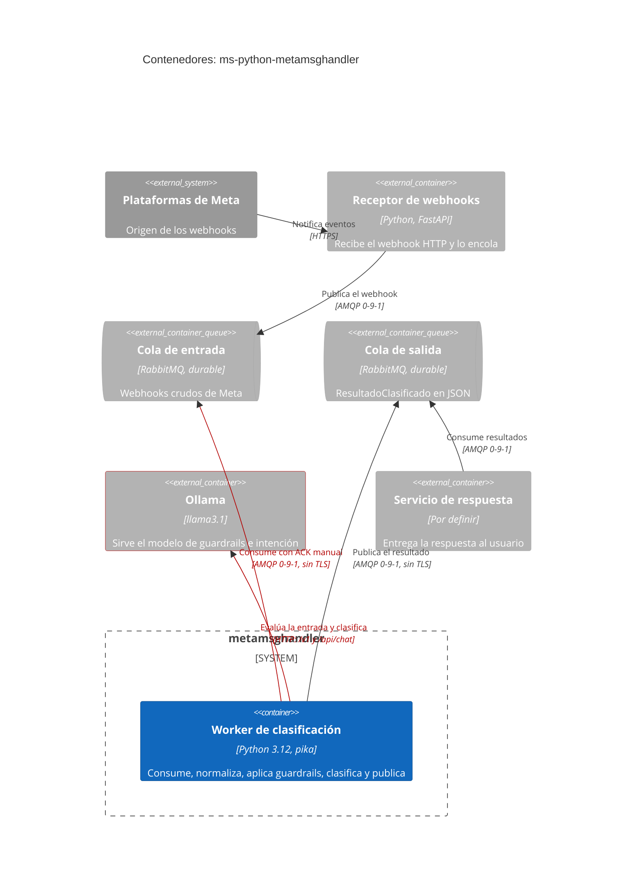
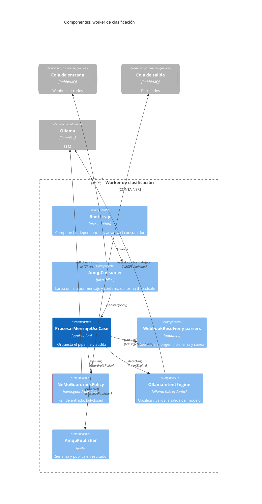
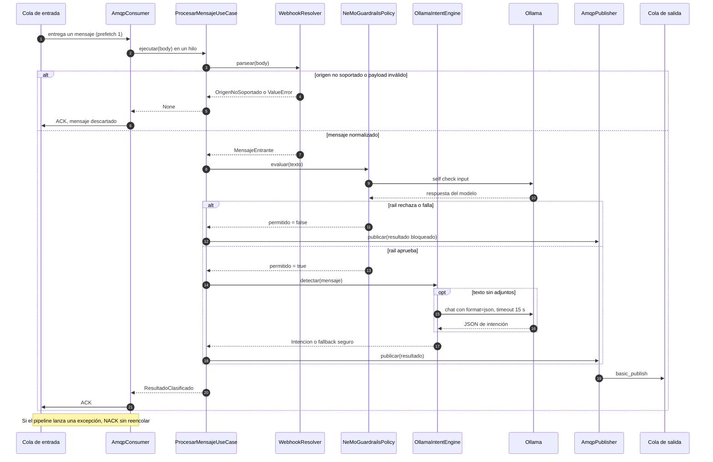
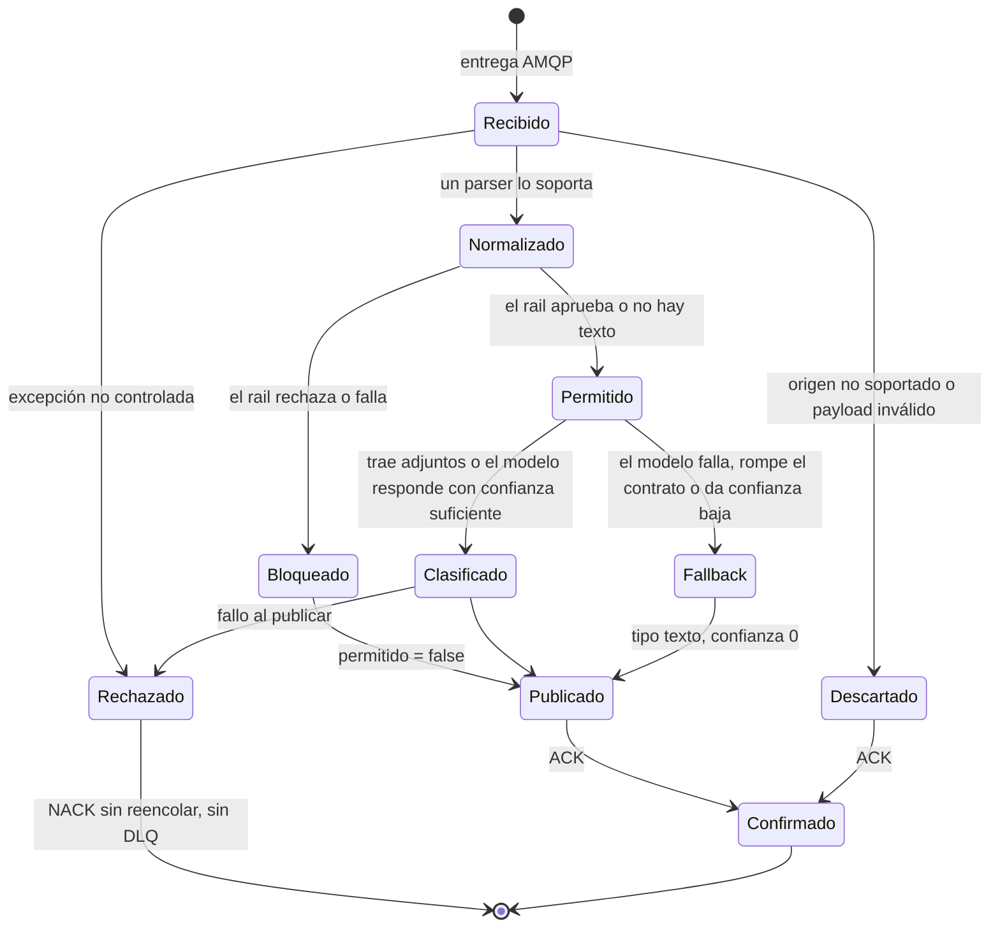
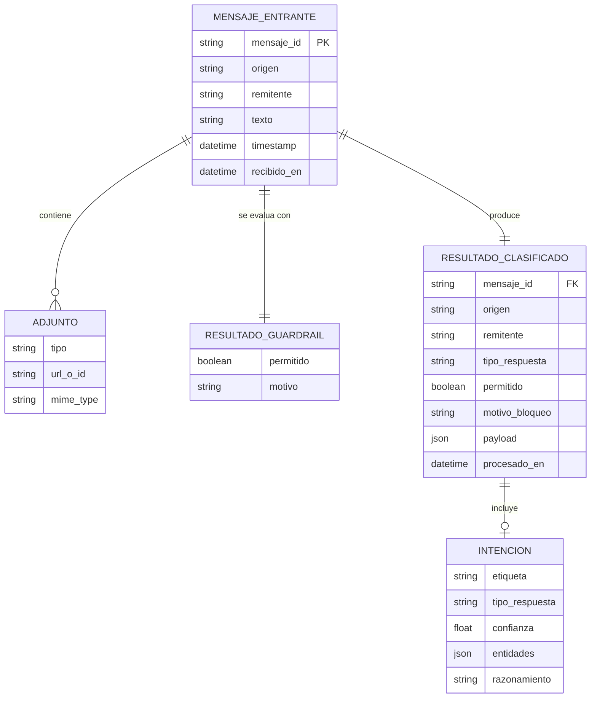
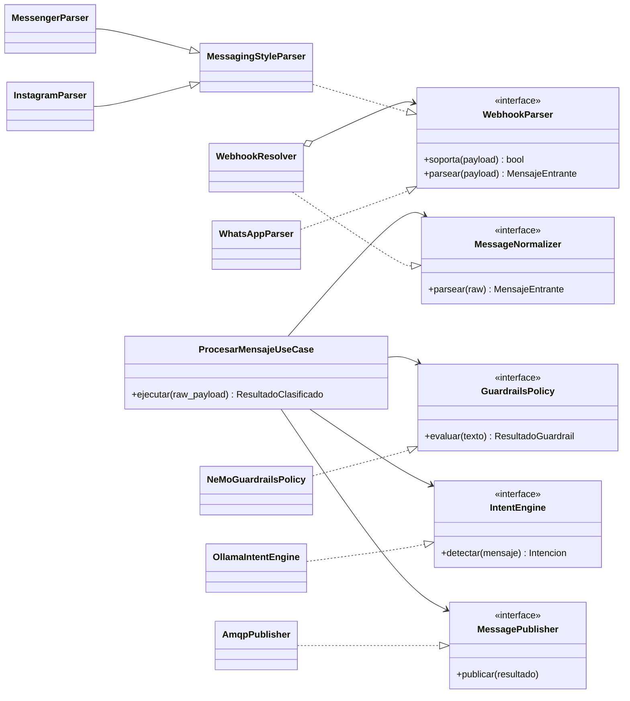

# Diseño del Sistema — ms-python-metamsghandler

* **Estado:** review
* **Fecha:** 2026-10-12
* **Decisores:** Jeremi Alcalá
* **Fase AI-DLC:** 02-design
* **Versión:** 0.2.0
* **Gate:** 1
* **Estilo arquitectónico:** Clean Architecture / hexagonal (puertos y adaptadores), worker dirigido por eventos
* **ADRs relacionadas:** ADR-0001, ADR-0002, ADR-0003, ADR-0004, ADR-0005, ADR-0006, ADR-0007

Documento de diseño reconstruido a partir del código de `develop` (4c7bb9e). Describe lo que
existe; lo que falta está marcado como deuda y enlazado a su amenaza.

## Contextos acotados (DDD)

| Bounded Context | Responsabilidad | Entidades núcleo | Código |
|---|---|---|---|
| Ingesta y normalización | Identificar el origen, sanear y traducir el webhook al modelo común | `MensajeEntrante`, `Adjunto`, `Origen` | `domain/ports/webhook_parser.py`, `infrastructure/adapters/` |
| Seguridad de IA | Decidir si un texto puede llegar al clasificador | `ResultadoGuardrail` | `domain/ports/guardrails_policy.py`, `infrastructure/guardrails/` |
| Clasificación de intención | Determinar qué quiere el usuario y qué estrategia de respuesta aplica | `Intencion`, `TipoRespuesta` | `domain/ports/intent_engine.py`, `infrastructure/llm/` |
| Publicación | Entregar el resultado aguas abajo y confirmar el mensaje de entrada | `ResultadoClasificado` | `domain/ports/message_publisher.py`, `infrastructure/amqp/` |

`infrastructure/security/` (JWE/JWK) e `infrastructure/persistence/` (modelos dinámicos sobre
MongoDB) vienen del template de origen. Ningún módulo del pipeline los importa: son código
heredado sin cablear (ver T11 del threat model).

## Vista C4 — Container

*Caption — eje estructura, fase 02-design: un único contenedor propio y sus dependencias. En
rojo, los enlaces que hoy van sin cifrar (`owasp-a04`) y el modelo de IA (`ai-sec`).*

El sistema es un solo proceso sin estado. Todo lo que necesita persistir vive en el broker.

## Vista C4 — Component (worker de clasificación)

*Caption — eje estructura, fase 02-design: el caso de uso solo conoce puertos. En rojo, los
tres componentes que tocan entrada no confiable o el modelo (`owasp-a05`, `ai-sec`).*

## Flujos críticos (comportamiento)

*Caption — eje comportamiento, fase 02-design: recorrido de un mensaje. Hay hasta dos llamadas
al modelo por mensaje y la confirmación a la cola de entrada llega después de publicar.*

Tres propiedades de este flujo que condicionan el threat model:

1. `prefetch_count=1` hace que el consumo sea serie aunque cada mensaje corra en su hilo:
   el broker no entrega el siguiente hasta que el actual se confirma.
2. El motor de intención tiene timeout (15 s); la llamada del rail no lo fija en este código.
3. El publicador abre una conexión nueva por mensaje y no usa confirmaciones del broker.

## Ciclo de vida de la entidad núcleo

*Caption — eje comportamiento, fase 02-design: estados de un mensaje dentro del pipeline. El
estado `Rechazado` es terminal y hoy equivale a perder el mensaje.*

## Modelo de datos y dominio

El servicio no tiene almacén propio. El diagrama es el modelo lógico de lo que viaja por memoria
y por la cola de salida.

*Caption — eje estructura, fase 02-design: modelo lógico. `RESULTADO_CLASIFICADO` es lo único
que sale del servicio; `INTENCION` falta cuando la entrada se bloquea.*

*Caption — eje estructura, fase 02-design: puertos del dominio y adaptadores que los
implementan. Las dependencias apuntan hacia el dominio.*

### Deuda de diseño observada

| Observación | Dónde | Efecto |
|---|---|---|
| La capa de aplicación importa de infraestructura (`STARTING_AT`, `enmascarar`, constantes de auditoría) | `application/procesar_mensaje.py` | Rompe la regla de dependencia que el propio módulo declara |
| `Settings()` y `logging.config.dictConfig` se ejecutan al importar | `amqp/consumer.py`, `amqp/publisher.py`, `presentation/bootstrap.py`, `main.py` | Importar un módulo exige tener la configuración completa; `logging_config.yaml` se abre con ruta relativa al directorio de trabajo |
| `Settings` exige variables que el pipeline no usa (`db_*`, `key_size`, `entity_*`, `dto_*`, `national_id_url`) | `config/settings.py` | Configuración y secretos innecesarios en cada despliegue |
| Código heredado sin cablear | `infrastructure/security/`, `infrastructure/persistence/` | Superficie y dependencias (mongoengine, pymongo, pillow, jwcrypto) sin uso; 0 % de cobertura |

## Contratos de API

El servicio no expone HTTP. Su interfaz son dos canales AMQP, especificados en
[`contracts/asyncapi.yaml`](contracts/asyncapi.yaml) (AsyncAPI 3.0). Los esquemas de salida se
generan desde los modelos pydantic del dominio, no se escriben a mano.

| Canal | Dirección | Mensaje | AuthN/Z | Garantía hoy |
|---|---|---|---|---|
| Cola de entrada (`queue_name`) | Recibe | Webhook de Meta (`object` = `page`, `whatsapp_business_account` o `instagram`) o sobre custom `jwe_body` | Usuario y contraseña del broker; sin permisos por cola definidos | Al menos una vez desde el broker; ACK tras publicar |
| Cola de salida (`output_queue_name`, por defecto `meta-classified`) | Envía | `ResultadoClasificado` en JSON | El mismo usuario del broker | A lo sumo una vez: sin confirmación del broker ni mensajes persistentes |

## Patrones de seguridad seleccionados (por amenaza DREAD priorizada)

Ordenados por puntuación. «Existe» significa implementado en el código; «Pendiente» es el
control que se adopta y aún no está.

| Amenaza | Patrón / Control | OWASP | Estado |
|---|---|---|---|
| T7 Consumo no acotado | Timeout en toda llamada externa, recorte de entrada, `prefetch_count=1`, límite de tamaño de mensaje en el broker | A10 · LLM10 | Existe: recorte, prefetch y timeout de intención. Pendiente: timeout del rail y límite de tamaño |
| T1 Prompt injection | Defensa en profundidad: sanitización, rail de entrada fail-closed, prompt que separa instrucciones de datos, salida validada | A06 · LLM01 | Existe. Pendiente: medir la eficacia con un corpus |
| T3 PII en logs | Enmascarado en origen y prohibición de registrar cuerpos de mensaje; logs estructurados | A09 | Existe en la auditoría. Pendiente: quitar el cuerpo del log del publicador |
| T6 Pérdida de mensajes | Dead-letter queue, confirmaciones del publicador, mensajes persistentes, `mandatory` | A10 · A08 | Pendiente |
| T5 Sin TLS | TLS en AMQP (`amqps`) y en el enlace con Ollama, o red privada con cifrado | A04 | Pendiente |
| T4 Mensajes falsos | Firma de Meta verificada aguas arriba, un usuario del broker por servicio y permisos por cola | A07 · A08 | Pendiente: depende del receptor |
| T2 Salida del LLM | Contrato cerrado para `etiqueta` (lista permitida) y esquema para `entidades` | A05 · LLM05 | Parcial: `tipo_respuesta` y `confianza` ya están acotados |
| T12 Despliegue | Manifest con límites, `securityContext`, secretos montados, imagen por digest | A02 | Pendiente: ADR-0006 |
| T8 Cadena de suministro | SCA, SBOM, imagen base por digest, build multi-etapa, modelo fijado por digest | A03 | Parcial: versiones fijadas |
| T10 URL de adjunto | Validar esquema y host, o marcar la URL como no confiable en el contrato | A05 | Pendiente |
| T9 Duplicados | Idempotencia por `mensaje_id` | A08 | Pendiente |
| T11 Código heredado | Eliminar o aislar lo que no se usa | A02 | Pendiente: decisión abierta |

El detalle de cada amenaza está en [`threat-model.md`](threat-model.md).
