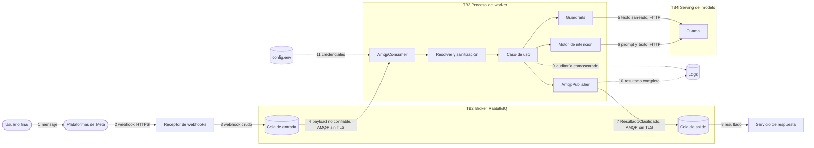
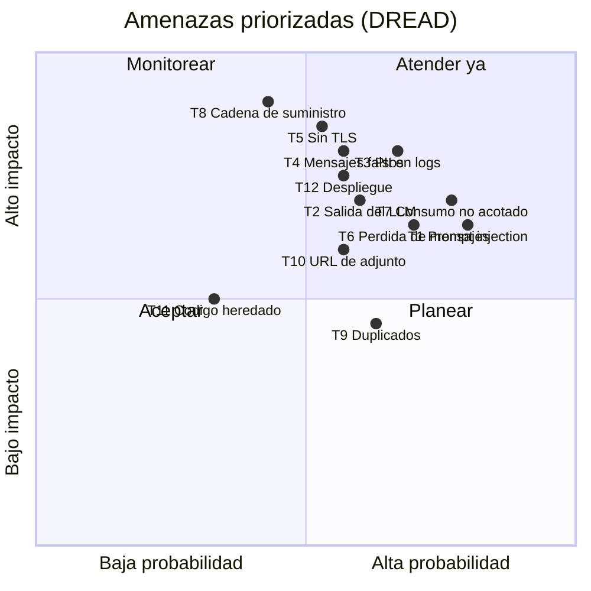

# Threat Model — ms-python-metamsghandler

* **Estado:** review
* **Fecha:** 2026-10-12
* **Decisores:** Jeremi Alcalá · seguridad <TODO: confirmar revisor>
* **Fase AI-DLC:** 02-design
* **Versión:** 0.2.0
* **Gate:** 1
* **Alcance:** servicio completo (worker de clasificación) y sus enlaces con RabbitMQ y Ollama. El receptor de webhooks y el servicio de respuesta entran solo como origen y destino de datos.
* **Metodología:** STRIDE + DREAD, con el Top 10 de OWASP 2025 y el Top 10 para aplicaciones LLM 2025
* **Clasificación de datos (ref):** `docs/00-project/data-classification.md`

Las amenazas salen de leer el código de `develop` (4c7bb9e), no de una plantilla. Cada una cita
el fichero donde se observa. Lo que no se pudo comprobar desde este repositorio está marcado
como supuesto.

## Diagrama de flujo de datos (DFD)

*Caption — eje comportamiento, fase 02-design: flujos numerados que alimentan el STRIDE.*

| Límite | Qué separa | Qué cruza |
|---|---|---|
| TB1 Internet / plataforma | Meta y el usuario, del receptor | Flujo 2. Fuera de este repo: lo defiende el receptor |
| TB2 Broker | Productores y consumidores de colas | Flujos 3, 4, 7 y 8. Quien tiene credenciales del broker puede publicar |
| TB3 Proceso del worker | El código propio, del resto | Flujos 4 a 7, 9 a 11 |
| TB4 Serving del modelo | El worker, del LLM | Flujos 5 y 6. Lo que vuelve del modelo es no confiable |
| TB5 Logs | El proceso, de quien lee logs | Flujos 9 y 10 |

## Análisis STRIDE

| Componente | Spoofing | Tampering | Repudiation | Info Disclosure | DoS | Elevation |
|---|---|---|---|---|---|---|
| Cola de entrada y mensaje (flujos 3, 4) | Cualquier cliente con credenciales del broker publica webhooks con el `from` que quiera (T4) | Mensaje alterado en tránsito: AMQP sin TLS (T5) | El resultado no conserva `eventId` ni productor | Texto y teléfono en claro en la red y en el disco del broker (T5) | Ráfaga o mensaje muy grande (T7) | — |
| Resolver y sanitización | — | `url_o_id`, `tipo` y `mime_type` del adjunto pasan sin sanear (T10) | — | El campo `object` de un payload rechazado se escribe en el log tal cual | Estructuras anidadas inesperadas provocan excepción y NACK (T6) | — |
| Guardrails (flujo 5) | — | Texto diseñado para que el modelo juez lo apruebe (T1) | El motivo del bloqueo es genérico: no queda qué regla saltó | — | Llamada al modelo sin timeout en este código (T7) | Un rail evadido deja pasar instrucciones al clasificador (T1) |
| Motor de intención (flujo 6) | — | El usuario induce `tipo_respuesta=action` o entidades arbitrarias (T2) | — | `razonamiento` puede repetir datos del usuario | Segunda llamada al modelo por mensaje (T7) | La etiqueta y las entidades las interpreta el servicio de respuesta (T2) |
| Publicador y cola de salida (flujo 7) | — | Sin TLS (T5) | Sin confirmación del broker: no se sabe si llegó (T6) | El cuerpo completo se escribe en el log (T3) | Una conexión nueva por mensaje | — |
| Logs y auditoría (flujos 9, 10) | — | Inyección de líneas vía campos no saneados | Auditoría sin identificador de correlación de extremo a extremo | Remitente y texto en claro (T3) | `FileHandler` sin rotación llena el disco | — |
| Configuración, imagen y despliegue (flujo 11) | — | Imagen base por tag móvil; `curl` a `sh.rustup.rs` ejecutado en el build (T8) | — | Secretos sin gestor definido (T12) | Manifest sin límites de recursos (T12) | Toolchain de compilación dentro de la imagen de ejecución (T8) |
| Código heredado JWE y MongoDB | — | — | — | El diseño lee la llave privada de MongoDB (T11) | `resource_from_model` carga la colección entera en memoria (T11) | — |

## Amenazas priorizadas (DREAD)

Escala 1 a 10 por criterio; la puntuación es la media. En el cuadrante, la probabilidad es la
media de reproducibilidad, explotabilidad y descubribilidad; el impacto, la de daño y afectados.

*Caption — eje trazabilidad, fase 02-design: nueve de las doce amenazas caen en «Atender ya».
Quedan fuera T8 (impacto alto, probabilidad menor), T9 y T11.*

| ID | Amenaza | D | R | E | A | D | Score | Control / ADR |
|---|---|---|---|---|---|---|---|---|
| T7 | DoS y consumo no acotado: el rail llama al modelo sin timeout, hay dos llamadas por mensaje y no hay límite de tamaño en el broker | 6 | 8 | 8 | 8 | 7 | 7.4 | Timeout en el rail, límite de tamaño, cuota por remitente · ADR-0003, ADR-0005 |
| T1 | Prompt injection que evade el rail y manipula la clasificación | 6 | 8 | 8 | 7 | 8 | 7.4 | Defensa en profundidad y evaluación con corpus · ADR-0004, ADR-0005 |
| T3 | Datos personales y texto de mensajes en logs: `publisher.py` registra el JSON completo | 7 | 10 | 4 | 9 | 6 | 7.2 | No registrar cuerpos; rotación y retención · RS-06, RS-12 |
| T6 | Pérdida silenciosa de mensajes: NACK sin DLQ, publicación sin confirmación ni persistencia, cola de salida sin enlazar, solo el primer mensaje de un lote | 6 | 8 | 7 | 7 | 6 | 6.8 | DLQ, confirmaciones, `delivery_mode=2`, `mandatory` · ADR-0003 |
| T4 | Mensajes falsos en la cola: no hay autenticidad a nivel de mensaje | 8 | 7 | 5 | 8 | 5 | 6.6 | Firma verificada aguas arriba, usuario del broker por servicio · RS-05 |
| T5 | AMQP y Ollama sin TLS: credenciales PLAIN y datos personales en claro | 8 | 7 | 4 | 9 | 5 | 6.6 | `amqps`, TLS o red privada cifrada hacia el modelo · RS-04, ADR-0006 |
| T2 | Salida del LLM propagada sin validar: `etiqueta`, `entidades` y `razonamiento` son libres | 7 | 6 | 6 | 7 | 6 | 6.4 | Lista permitida de etiquetas, esquema de entidades · ADR-0004 |
| T12 | Despliegue mal configurado: manifest borrador con `:latest`, sin límites, sin `securityContext`, sin montaje de secretos | 7 | 6 | 5 | 8 | 6 | 6.4 | Manifest endurecido, gestor de secretos · ADR-0006 |
| T8 | Cadena de suministro: `FROM python:3.12` sin digest, `curl` de rustup en el build, dependencias sin hash, herramientas de desarrollo en la imagen, modelo descargado por tag | 9 | 4 | 4 | 9 | 5 | 6.2 | SCA, SBOM, digest, build multi-etapa · RS-10 |
| T10 | URL de adjunto de Messenger o Instagram sin validar: SSRF en quien la descargue | 7 | 6 | 6 | 5 | 5 | 5.8 | Validar esquema y host o marcarla como no confiable · RS-14 |
| T9 | Duplicados por reentrega: no hay idempotencia | 4 | 8 | 6 | 5 | 5 | 5.6 | Deduplicar por `mensaje_id` · RS-11 |
| T11 | Código heredado JWE y MongoDB: conexión a MongoDB al importar, llave privada en base de datos, carga completa de colección | 6 | 3 | 3 | 4 | 4 | 4.0 | Eliminar o aislar · decisión abierta |

## Controles y trazabilidad

Para cada amenaza: qué control existe ya (con su evidencia), qué falta, y en qué gate se cierra.
Las filas enlazan con `.ai-dlc/owasp-mapping.md` (anexo del servicio) y con los requisitos del
PRD.

| ID | Control existente (evidencia) | Control pendiente | OWASP | Req | Gate |
|---|---|---|---|---|---|
| T1 | Sanitización NFKC y de caracteres de control (`adapters/sanitize.py`); rail de entrada fail-closed (`guardrails/nemo_policy.py`); prompt que ordena no seguir instrucciones del mensaje (`llm/prompts.py`); salida validada (`llm/ollama_engine.py`) | Corpus de evaluación con jailbreaks y mensajes legítimos; revisar el prompt del rail | A06 · LLM01 | RS-03 | 3 |
| T2 | `tipo_respuesta` de un enum cerrado, confianza acotada a [0, 1], umbral 0.3, fallback (`_RespuestaLLM`) | Lista permitida de etiquetas, esquema y tamaño máximo para `entidades` y `razonamiento` | A05 · LLM05 | RS-02 | 2 |
| T3 | Remitente enmascarado en las trazas `audit:` (`shared/general.py`); telemetría de NeMo desactivada | Quitar el cuerpo del `log.info` del publicador; rotación; política de retención | A09 · LLM02 | RS-06, RS-12 | 2 |
| T4 | Ninguno en este servicio | Confirmar la verificación de `X-Hub-Signature-256` en el receptor; credenciales y permisos por servicio en el broker; conservar `eventId` | A07 · A08 | RS-05 | 1 |
| T5 | Ninguno | `amqps` con verificación de certificado; TLS o red privada hacia Ollama | A04 | RS-04 | 4 |
| T6 | ACK solo tras publicar; NACK ante excepción (`amqp/consumer.py`) | DLQ; `confirm_delivery`; `delivery_mode=2`; `mandatory=True`; enlazar la cola de salida; procesar todos los mensajes del lote | A10 · A08 | RS-07 | 2 |
| T7 | Texto recortado a 4096; `prefetch_count=1`; timeout de 15 s en el motor de intención | Timeout en el rail; `max-length` en la cola; límite por remitente | A10 · LLM10 | RS-08 | 2 |
| T8 | Versiones fijadas en `requirements.txt`; usuario no-root en la imagen | SCA y SBOM en CI; imagen base por digest; build multi-etapa sin toolchain; separar dependencias de desarrollo; fijar el modelo por digest | A03 · LLM03 | RS-10, RS-13 | 2 y 4 |
| T9 | Ninguno | Deduplicación por `mensaje_id` con caducidad | A08 | RS-11 | 2 |
| T10 | Los media-id de WhatsApp se sanean como identificadores | Validar esquema `https` y host de las URL de Messenger e Instagram; sanear `tipo` y `mime_type` | A05 | RS-14 | 2 |
| T11 | El pipeline no importa esos módulos (comprobado con `grep`) | Decidir: eliminar el código y sus dependencias, o cablearlo con un diseño de llaves | A02 · A04 | — | 2 |
| T12 | `config.env` fuera del repo y de la imagen (`.gitignore`, `.dockerignore`) | Manifest con límites, sondas, `securityContext` y secretos montados; imagen con etiqueta inmutable | A02 | RS-09 | 4 |

## Observaciones que requieren revisión humana

1. **Prompt del rail.** `guardrails/config/config.yml` termina la tarea `self_check_input` con una
   respuesta ya escrita que afirma que el mensaje debe bloquearse (cambio del commit 4c7bb9e).
   Los tests unitarios mockean el motor de NeMo, así que no hay evidencia de cómo responde el
   rail real ante un mensaje legítimo ni ante un jailbreak. Hay que comprobarlo contra Ollama
   antes de fiarse del control.
2. **Un solo modelo para dos funciones.** `llama3.1` hace de juez de seguridad y de clasificador.
   Una técnica que engaña al modelo puede servir para las dos capas.
3. **Enrutado de la cola de salida.** El publicador declara la cola pero no la enlaza. Con el
   exchange por defecto, la clave de enrutado debería ser el nombre de la cola, y los valores
   por defecto son distintos (`meta-classified` y `meta.classified`). Con un exchange con nombre,
   depende de un enlace que este servicio no crea. En ambos casos, sin `mandatory`, un mensaje
   sin ruta se descarta sin error.
4. **Receptor aguas arriba.** En la copia local de `wh-python-fastapi-messenger` (86d553b,
   2026-07-02) no aparece verificación de la firma de Meta (búsqueda de `X-Hub-Signature` y
   `hmac`), y la llamada que cifraba el sobre `jwe_body` está comentada. Es otro repositorio y
   puede haber cambiado: confirmar con su owner.
5. **Correlación por inquilino.** El sobre custom trae `botId` y `eventId`; el resultado no. Si
   hay más de un bot, el servicio de respuesta no puede distinguirlos.

## Riesgos de IA (Top 10 LLM 2025)

| Riesgo | Aplica | Tratamiento |
|---|---|---|
| LLM01 Prompt injection | Sí | T1 |
| LLM02 Divulgación de información sensible | Sí | T3 |
| LLM03 Cadena de suministro del modelo | Sí | T8: el modelo se obtiene por tag |
| LLM05 Manejo inadecuado de la salida | Sí | T2 |
| LLM06 Agencia excesiva | Indirecto | El servicio no ejecuta herramientas, pero `action` dispara lógica aguas abajo: T2 |
| LLM07 Fuga del prompt de sistema | No | El prompt es público y no contiene secretos |
| LLM10 Consumo no acotado | Sí | T7 |
| LLM04, LLM08, LLM09 | No | No hay entrenamiento, ni base vectorial, ni se genera texto para el usuario |
