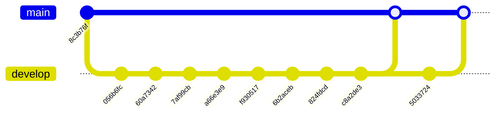

# Historial de implementación — ms-python-metamsghandler

* **Estado:** review
* **Fecha:** 2026-10-12
* **Decisores:** Jeremi Alcalá
* **Fase AI-DLC:** 03-implementation
* **Versión:** 0.3.0
* **Gate:** 2
* **Rama principal:** main
* **Estrategia de branching:** GitFlow reducido: `develop` se integra en `main` por pull request

Documento generado, no escrito a mano. Para regenerarlo tras cada merge o tag:

```bash
python ~/.claude/skills/ai-dlc/scripts/gitgraph_from_log.py . --branch origin/main --out repo-history.raw.md
python .ai-dlc/scripts/assemble_repo_history.py repo-history.raw.md docs/03-implementation/repo-history.md
```

El grafo sigue la primera línea de `origin/main`; la bitácora incluye todas las ramas. Por eso
`4c7bb9e` aparece en la bitácora y no en el grafo: está en `develop` y aún no se ha fusionado.
El script de la skill emite `branch develop` una vez por merge y Mermaid rechaza crear dos
veces la misma rama; el ensamblado elimina la repetición.

## Historial del repositorio (documentación viva)

Derivado de `git log` con `scripts/gitgraph_from_log.py`. Regenerar tras cada merge o tag para
mantener la traza sincronizada. Los tags SemVer enlazan con las versiones del `CHANGELOG.md`.

### Grafo de commits y merges



### Bitácora de cambios (fiel al repo)

| Commit | Tipo | Tags | Autor | Fecha | Mensaje |
|---|---|---|---|---|---|
| `771c73a` | merge | — | Jeremi J. Alcalá M. | 2026-06-20 | Merge pull request #2 from jeremialcala/develop |
| `4c7bb9e` | commit | — | Jeremi Alcala | 2026-06-18 | Enhance WhatsApp message parsing and add custom payload support: update WhatsAppParser to handle custom JWE payloads, improve queue durability in AMQP publisher and consumer, and add tests for new functionality. |
| `5033724` | commit | — | Jeremi Alcala | 2026-06-18 | Enhance Docker setup and logging configuration: update .dockerignore to include logs directory, modify Dockerfile to create logs directory with appropriate permissions, and adjust logging configuration to write logs to the new directory. |
| `fa24175` | merge | — | Jeremi J. Alcalá M. | 2026-06-18 | Merge pull request #1 from jeremialcala/develop |
| `c8a2de3` | commit | — | Jeremi Alcala | 2026-06-18 | Enhance thread management in AMQP consumer: add timeout for worker thread joins to prevent hanging shutdowns and log warnings for unresponsive threads. |
| `824fdcd` | commit | — | Jeremi Alcala | 2026-06-17 | Enhance Docker setup and security: update .dockerignore to exclude sensitive files, modify Dockerfile to run as non-root user, and improve connection handling in AMQP publisher and consumer. Update config examples and tests for better clarity and functionality. |
| `6b2aceb` | commit | — | Jeremi Alcala | 2026-06-17 | Refactor message processing architecture: introduce MessageNormalizer interface and update WebhookResolver to implement it; enhance domain ports with new message normalization capabilities. |
| `f930517` | commit | — | Jeremi Alcala | 2026-06-17 | Fix code block formatting in README.md for better clarity |
| `a66e3e9` | commit | — | Jeremi Alcala | 2026-06-17 | Implement logging and persistence utilities; add security operations for JWE/JWK; enhance shared constants and general utilities; refactor presentation layer and tests for improved structure and clarity. |
| `7af99cb` | commit | — | Jeremi Alcala | 2026-06-17 | Refactor README.md to update project description and architecture details for ms-python-metamsghandler |
| `60a7342` | commit | — | Jeremi Alcala | 2026-06-17 | Update Dockerfile to use Python 3.12 and modify config.env.example for service name and queue settings |
| `056b6fc` | commit | — | Jeremi Alcala | 2026-06-17 | Add .dockerignore file to exclude unnecessary files from Docker context |
| `8c3b76f` | commit | — | Jeremi J. Alcalá M. | 2026-06-17 | Initial commit |

## Trazabilidad tag ↔ versión ↔ decisión

El repositorio no tiene tags. La tabla se rellena al cortar la primera versión.

| Tag | Versión CHANGELOG | ADR / feature | Nota |
|---|---|---|---|
| — | Unreleased | ADR-0001 a ADR-0007 · MMH-F01 | Adopción de AI-DLC en la rama `chore/ai-dlc-adoption`, sin commitear a 2026-10-12 |

## Decisiones ya implementadas y su commit

| Commit | Fecha | Decisión documentada |
|---|---|---|
| `a66e3e9` | 2026-06-17 | ADR-0002 (capas y puertos), ADR-0004 (motor de intención), ADR-0005 (guardrails) |
| `6b2aceb` | 2026-06-17 | ADR-0002: puerto `MessageNormalizer` |
| `824fdcd` | 2026-06-17 | ADR-0003: manejo de conexiones AMQP; imagen con usuario no-root |
| `c8a2de3` | 2026-06-18 | ADR-0003: límite de espera al cerrar los hilos |
| `4c7bb9e` | 2026-06-18 | ADR-0003: colas durables; ADR-0005: Ollama por la API `/v1`; sobre custom `jwe_body` |
